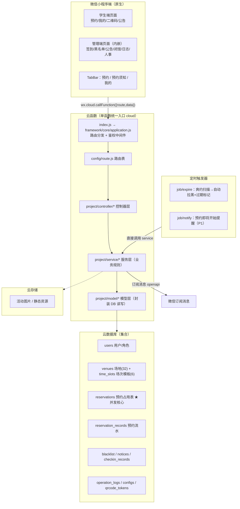
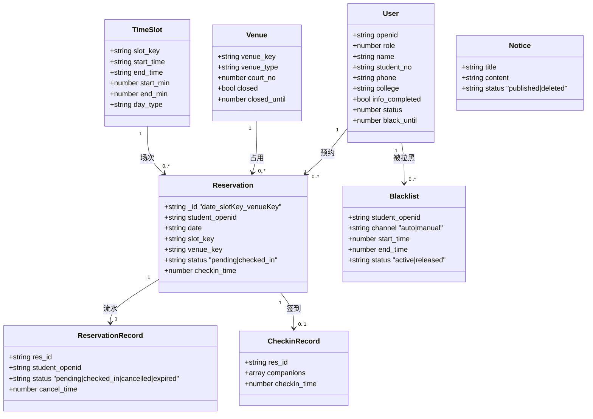
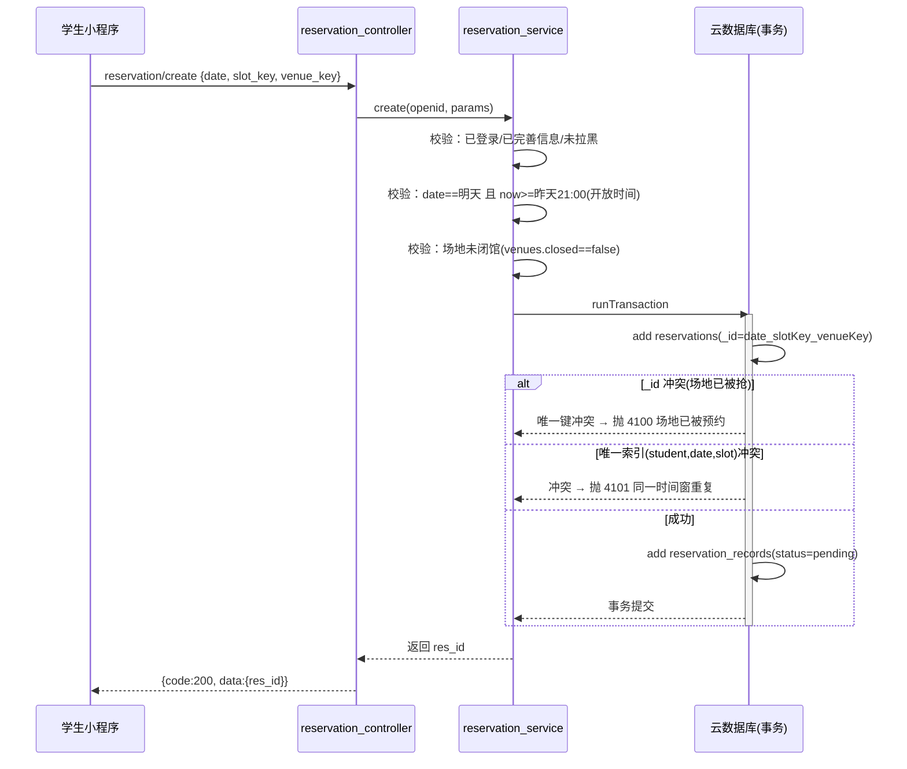
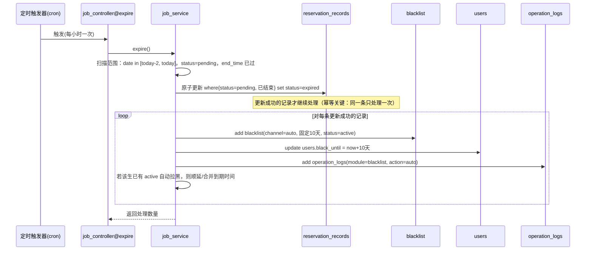
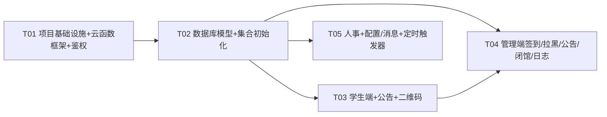

# 体育馆预约微信小程序 — 系统架构设计与任务分解

> 项目：gymreserve　|　架构师：高见远　|　版本：v1.0
> 技术栈：微信小程序（原生）+ 微信云开发（云函数 + 云数据库 + 云存储 + 定时触发器）
> 鉴权：微信 openid
> 需求依据：`docs/PRD.md` + 主理人裁定的技术默认决策（本设计已全部采纳，不再重复询问）

---

## 0. 设计原则与关键取舍（先读）

1. **单云函数统一入口 + 路由表**：沿用参考工程 `SmartSport` 的 MVC 分层思想（`index.js → application.js → route.js → controller → service → model`），但针对本项目重新裁剪，去除参考工程的 MySQL、导出、缓存等冗余能力，只保留：路由分发、鉴权中间件、返回封装、数据库工具、模型基类。
2. **并发正确性靠"数据库唯一约束"，不靠"先查后插"**：微信云数据库在高并发下"查询再插入"存在竞态窗口，因此预约的「不超约」「防重复」两条硬约束全部下沉到数据库唯一键，配合云数据库事务，从根上保证正确性（详见 §3、§5.1）。
3. **"有效占用"与"历史流水"分表**：取消/爽约要立即释放场地（释放唯一键占位），但历史记录又要保留（含已取消/已完成）。用两张表解耦：`reservations`（占用表，唯一键强约束，取消即物理删除）+ `reservation_records`（流水表，全生命周期状态）。
4. **时间与日期分离**：日期用 `"YYYY-MM-DD"` 字符串；时刻/时间点用毫秒时间戳（number）；场次用 `slot_key = "HHmm_HHmm"`（如 `1820_1930`）标识，便于唯一索引与范围比较。

---

## 1. 总体架构

### 1.1 云开发资源拓扑



### 1.2 分层职责

| 层 | 文件位置 | 职责 |
|---|---|---|
| 入口 | `cloudfunctions/cloud/index.js` | 云函数 `exports.main`，委托给 application |
| 框架 | `framework/core/application.js` | 取 openid → 路由解析 → 鉴权中间件 → 实例化 controller → 调 action → 统一返回 |
| 路由 | `config/route.js` | `route 字符串 → {controller, action, role}` 映射，role 用于鉴权 |
| 控制器 | `project/controller/*` | 参数校验、组装入参、调用 service、返回 |
| 服务 | `project/service/*` | 业务规则（事务、状态机、防重复、幂等、日志） |
| 模型 | `project/model/*` | 集合名 + 字段结构 + DB 读写封装（继承 model.js 基类） |
| 初始化 | `project/init/init_data.js` | 建集合、初始化场馆/场次/配置/超管 |

---

## 2. 云函数设计

### 2.1 统一入口与鉴权中间件

- **采用单云函数统一入口**（云函数名 `cloud`）。小程序端所有请求统一走 `wx.cloud.callFunction({ name: 'cloud', data: { route, ...payload } })`。
- **openid 获取**：只信任服务端 `cloud.getWXContext().OPENID`，前端传来的 openid 一律忽略。
- **鉴权中间件**（在 `application.js` 内执行）：
  1. 从 `getWXContext()` 取 openid；
  2. 查 `users` 表（未注册视为 `role=0` 匿名/游客）；
  3. 取该 openid 的**最高角色**（主理人已裁定：同一 openid 取最高角色）；
  4. 比较 `route.role` 与用户角色等级，不足则抛 `AppError(无权限)`；
  5. 被拉黑（`users.black_until > now`）时，预约类/二维码类 route 直接拒绝并提示剩余天数。
- 角色等级数值（越大权限越高）：`0=匿名 1=学生 2=普通管理员 3=超级管理员 4=老师 5=现任主席`。权限判断规则：
  - `role=4/5`（老师/主席）：可访问**全部** route（含人事）；
  - `role=3`（超管）：可访问除人事外的全部；
  - `role=2`（普管）：签到/手动拉黑/公告/签到记录；
  - `role=1`（学生）：预约/我的/二维码/公告查看；
  - `role=0`（匿名）：仅公告查看。

### 2.2 路由表（`config/route.js`）

> 每条 route 标注 `role` = 最小所需角色等级。`role:0` 表示匿名可访问。

#### 2.2.1 passport（登录/信息）

| route | controller@action | role | 说明 |
|---|---|---|---|
| `passport/login` | passport_controller@login | 0 | 登录：返回 openid、角色、是否完善信息、是否被拉黑 |
| `passport/save_profile` | passport_controller@saveProfile | 1 | 完善个人信息（姓名/学号/电话/学院，必填） |

#### 2.2.2 学生预约 / 场馆 / 场次

| route | controller@action | role | 说明 |
|---|---|---|---|
| `venue/list` | venue_controller@list | 1 | 三馆场地列表 + 闭馆状态 |
| `slot/list` | venue_controller@slotList | 1 | 次日（可约日）场次列表 |
| `reservation/status` | reservation_controller@status | 1 | 某日某场次各场地可约/已满状态 |
| `reservation/create` | reservation_controller@create | 1 | 提交预约（事务，先到先得） |
| `reservation/cancel` | reservation_controller@cancel | 1 | 取消预约（开始前30分钟） |

#### 2.2.3 我的 / 记录 / 二维码

| route | controller@action | role | 说明 |
|---|---|---|---|
| `my/reservations` | my_controller@reservations | 1 | 我的预约列表（含全部状态） |
| `my/records` | my_controller@records | 1 | 近7天预约+签到记录 |
| `my/profile` | my_controller@profile | 1 | 我的信息 |
| `qrcode/generate` | qrcode_controller@generate | 1 | 生成动态二维码 token（20s） |
| `qrcode/valid_booking` | qrcode_controller@validBooking | 1 | 当前有效预约信息（二维码页展示） |

#### 2.2.4 公告

| route | controller@action | role | 说明 |
|---|---|---|---|
| `notice/latest` | notice_controller@latest | 0 | 最新一条公告（进入弹窗） |
| `notice/list` | notice_controller@list | 0 | 公告列表 |
| `notice/detail` | notice_controller@detail | 0 | 公告详情 |

#### 2.2.5 admin 签到 / 签到记录

| route | controller@action | role | 说明 |
|---|---|---|---|
| `admin/scan` | admin_controller@scan | 2 | 扫码校验二维码 token，返回学生+场次信息 |
| `admin/checkin` | admin_controller@checkin | 2 | 确认签到（含附属人员登记） |
| `admin/checkin_records` | admin_controller@checkinRecords | 2 | 当日签到记录（按场馆/场次筛选） |

#### 2.2.6 黑名单

| route | controller@action | role | 说明 |
|---|---|---|---|
| `blacklist/list` | blacklist_controller@list | 2 | 黑名单列表 |
| `blacklist/add` | blacklist_controller@add | 2 | 手动拉黑（自定义时长） |
| `blacklist/release` | blacklist_controller@release | 3 | 解除拉黑（超管及以上） |

#### 2.2.7 场地闭馆 / 系统日志

| route | controller@action | role | 说明 |
|---|---|---|---|
| `venue/close` | venue_controller@close | 3 | 设置临时闭馆 / 恢复开放 |
| `venue/close_list` | venue_controller@closeList | 3 | 闭馆列表 |
| `log/list` | log_controller@list | 3 | 系统日志（拉黑记录 + 管理员操作记录） |

#### 2.2.8 人事（老师/主席专属）

| route | controller@action | role | 说明 |
|---|---|---|---|
| `hr/admin_list` | hr_controller@adminList | 4 | 管理员列表 |
| `hr/admin_add` | hr_controller@adminAdd | 4 | 任免/新增管理员 |
| `hr/admin_remove` | hr_controller@adminRemove | 4 | 移除/禁用管理员 |
| `hr/admin_assign` | hr_controller@adminAssign | 4 | 分配/调整/禁用权限 |
| `hr/student_list` | hr_controller@studentList | 4 | 学生名单 |
| `hr/student_detail` | hr_controller@studentDetail | 4 | 学生详情 |
| `hr/student_edit` | hr_controller@studentEdit | 4 | 修改学生信息 |

#### 2.2.9 配置 / 消息 / 定时任务

| route | controller@action | role | 说明 |
|---|---|---|---|
| `config/get` | config_controller@get | 0 | 获取公开配置（场次/开放时间/活动图） |
| `config/set` | config_controller@set | 3 | 修改基础配置（P2） |
| `config/activity_pic` | config_controller@activityPic | 3 | 更换活动图片（P1） |
| `message/subscribe` | message_controller@subscribe | 1 | 订阅消息授权上报（P1） |
| `job/expire` | job_controller@expire | - | 定时：爽约扫描→自动拉黑+过期标记（由触发器调用，不走鉴权） |
| `job/notify` | job_controller@notify | - | 定时：预约即将开始提醒（P1） |

> `job/*` 由定时触发器直接触发，不经过鉴权中间件（在 application 中识别 route 前缀 `job/` 跳过角色校验，但仍校验来源为触发器）。

---

## 3. 数据库集合设计

> 索引策略：云数据库在**控制台**为集合创建索引。本设计把两条关键并发约束分别落到：①`_id` 组合主键（天然唯一，无需额外建索引）②一条**组合唯一索引**（需在控制台手动建，见 §9 共享知识）。其余为普通查询索引（建议建，非强约束）。

### 3.0 集合总览

| 集合 | 用途 | 关键唯一约束 |
|---|---|---|
| `users` | 用户/角色/黑名单状态 | `_id` = openid 唯一 |
| `venues` | 场地（32 条静态+闭馆状态） | `_id` = venue_key 唯一 |
| `time_slots` | 场次模板（6 条） | `_id` = slot_key 唯一 |
| `reservations` | 预约占用表（并发核心） | `_id`=日期_场次_场地唯一；唯一索引(student,date,slot) |
| `reservation_records` | 预约流水（全状态） | 普通索引 |
| `blacklist` | 黑名单 | 普通索引 |
| `notices` | 公告 | 普通索引 |
| `checkin_records` | 签到记录（含附属人员） | 普通索引 |
| `operation_logs` | 操作日志 | 普通索引 |
| `configs` | 基础配置 | `_id` = key 唯一 |
| `qrcode_tokens` | 动态二维码 token（防截图） | `_id` = openid 唯一（一个学生一条，覆盖） |

### 3.1 `users` 用户表

| 字段 | 类型 | 含义 |
|---|---|---|
| `_id` | string | = openid（唯一） |
| `openid` | string | 微信 openid |
| `role` | number | 角色 1学生/2普管/3超管/4老师/5主席 |
| `name` | string | 姓名 |
| `student_no` | string | 学号 |
| `phone` | string | 电话 |
| `college` | string | 学院/单位 |
| `info_completed` | bool | 是否已完善个人信息 |
| `status` | number | 1正常 / 0禁用 |
| `black_until` | number | 拉黑到期时间戳(ms)，0=未拉黑（冗余，加速判断） |
| `create_time` | number | 注册时间(ms) |
| `update_time` | number | 更新时间(ms) |

- 索引：`_id` 即唯一；建议 `(role)`、`(black_until)`。

### 3.2 `venues` 场地表（初始化 32 条）

| 字段 | 类型 | 含义 |
|---|---|---|
| `_id` | string | = `venue_key`，如 `badminton#3`、`gym#20`（唯一） |
| `venue_key` | string | 场馆类型+编号组合键 |
| `venue_type` | string | `badminton` / `pingpong` / `gym` |
| `venue_type_name` | string | 羽毛球场/乒乓球场/健身房 |
| `court_no` | number | 馆内编号 1~N |
| `closed` | bool | 是否临时闭馆 |
| `closed_until` | number | 闭馆截止时间戳(ms)，0=不限时 |
| `update_time` | number | 更新时间(ms) |

- 索引：`_id` 唯一；建议 `(venue_type, court_no)`、`(closed)`。
- 场地唯一标识规则（已裁定）：`场馆类型 + 场地编号` 组合键。

### 3.3 `time_slots` 场次模板表（初始化 6 条）

| 字段 | 类型 | 含义 |
|---|---|---|
| `_id` | string | = `slot_key`，如 `1820_1930`（唯一） |
| `slot_key` | string | 场次时间窗标识 `HHmm_HHmm` |
| `start_time` | string | `"18:20"` |
| `end_time` | string | `"19:30"` |
| `start_min` | number | 开始分钟数（18:20 → 1100） |
| `end_min` | number | 结束分钟数（19:30 → 1170） |
| `day_type` | string | `weekday` / `weekend` / `all` |
| `sort` | number | 排序号 |

- 默认数据（与 PRD 一致）：
  | slot_key | start~end | day_type |
  |---|---|---|
  | `1300_1410` | 13:00~14:10 | weekend |
  | `1420_1530` | 14:20~15:30 | weekend |
  | `1540_1650` | 15:40~16:50 | weekend |
  | `1700_1810` | 17:00~18:10 | weekend |
  | `1820_1930` | 18:20~19:30 | all |
  | `1940_2050` | 19:40~20:50 | all |
- **某日场次计算**：周一~周五（weekday）取 `day_type ∈ {weekday, all}`；周六~周日取 `day_type ∈ {weekend, all}`。

### 3.4 `reservations` 预约占用表（★并发核心）

| 字段 | 类型 | 含义 |
|---|---|---|
| `_id` | string | = `${date}_${slot_key}_${venue_key}`，如 `2026-10-26_1820_1930_badminton#3`（组合主键，**天然唯一 → 场地不超约**） |
| `student_openid` | string | 预约学生 openid |
| `student_name` | string | 学生姓名（快照） |
| `student_no` | string | 学号（快照） |
| `date` | string | 预约日期 `"YYYY-MM-DD"` |
| `slot_key` | string | 场次 `"1820_1930"` |
| `venue_key` | string | 场地 `"badminton#3"` |
| `venue_type` | string | 场馆类型 |
| `court_no` | number | 场地编号 |
| `status` | string | `pending` 待签到 / `checked_in` 已签到 |
| `checkin_time` | number | 签到时间戳(ms)，未签到=0 |
| `create_time` | number | 提交成功时间(ms)（先到先得依据） |

- **组合唯一索引 `uniq_student_slot` on `(student_openid, date, slot_key)`**（控制台手动建，**唯一**）→ **防重复预约**（同一学生同一时间窗跨场馆只约1个）。
- 建议普通索引：`(date, slot_key)`、`(student_openid)`。
- **取消 = 物理删除本记录**（立即释放 `_id` 与唯一索引占位），历史由 `reservation_records` 保留。

### 3.5 `reservation_records` 预约流水表（全状态，历史/查询依据）

| 字段 | 类型 | 含义 |
|---|---|---|
| `_id` | string | 自生成（云数据库 `add` 返回） |
| `res_id` | string | 关联 `reservations._id` |
| `student_openid` | string | 学生 openid |
| `student_name` | string | 姓名快照 |
| `date` | string | 预约日期 |
| `slot_key` | string | 场次 |
| `venue_key` | string | 场地 |
| `venue_type` | string | 场馆类型 |
| `venue_type_name` | string | 场馆名 |
| `court_no` | number | 场地编号 |
| `status` | string | `pending`/`checked_in`/`cancelled`/`expired` |
| `cancel_time` | number | 取消时间(ms)，0=未取消 |
| `create_time` | number | 创建时间(ms) |
| `update_time` | number | 更新时间(ms) |

- 索引建议：`(student_openid, date)`、`(date, status)`、`(student_openid, status)`。

### 3.6 `blacklist` 黑名单表

| 字段 | 类型 | 含义 |
|---|---|---|
| `_id` | string | 自生成 |
| `student_openid` | string | 学生 openid |
| `student_name` | string | 姓名快照 |
| `channel` | string | `auto`（爽约自动）/ `manual`（管理员手动） |
| `reason` | string | 拉黑原因（爽约/手动备注） |
| `duration_days` | number | 拉黑天数（auto 固定 10） |
| `start_time` | number | 拉黑时间(ms) |
| `end_time` | number | 到期时间(ms) |
| `status` | string | `active` 生效中 / `released` 已解除（逻辑删除，审计保留） |
| `operator_openid` | string | 谁拉黑（爽约为 `system`） |
| `operator_name` | string | 操作人姓名 |
| `release_by_openid` | string | 谁解除 |
| `release_by_name` | string | 解除人姓名 |
| `release_time` | number | 解除时间(ms) |
| `release_reason` | string | 解除原因 |
| `create_time` | number | 创建时间(ms) |

- 索引建议：`(student_openid, status)`、`(status, end_time)`。
- **两条通道**：`channel=auto`（爽约，固定10天，定时触发器写入）vs `channel=manual`（管理员自定义时长）。解除/到期均不改物理删除，改 `status=released`，历史保留供审计。

### 3.7 `notices` 公告表

| 字段 | 类型 | 含义 |
|---|---|---|
| `_id` | string | 自生成 |
| `title` | string | 标题 |
| `content` | string | 内容 |
| `status` | string | `published` / `deleted`（逻辑删除） |
| `author_openid` | string | 发布人 |
| `author_name` | string | 发布人姓名 |
| `publish_time` | number | 发布时间(ms) |
| `update_time` | number | 更新时间(ms) |

- 索引建议：`(status, publish_time)`。

### 3.8 `checkin_records` 签到记录表（含附属人员）

| 字段 | 类型 | 含义 |
|---|---|---|
| `_id` | string | = `res_id`（一条预约只签一次，幂等） |
| `res_id` | string | 关联预约 |
| `student_openid` | string | 学生 openid |
| `student_name` | string | 姓名 |
| `student_no` | string | 学号 |
| `date` | string | 日期 |
| `slot_key` | string | 场次 |
| `venue_key` | string | 场地 |
| `venue_type` | string | 场馆类型 |
| `venue_type_name` | string | 场馆名 |
| `court_no` | number | 场地编号 |
| `companions` | array | 附属人员 `[{name, phone}]`，数量不限（非系统用户） |
| `admin_openid` | string | 签到操作管理员 |
| `admin_name` | string | 管理员姓名 |
| `checkin_time` | number | 签到时间(ms) |

- 索引建议：`(date, venue_type)`、`(date, slot_key)`、`(student_openid, date)`。

### 3.9 `operation_logs` 操作日志表

| 字段 | 类型 | 含义 |
|---|---|---|
| `_id` | string | 自生成 |
| `module` | string | `blacklist`/`hr`/`venue_close`/`notice`/`config`/`checkin` |
| `action` | string | `add_blacklist`/`release_blacklist`/`assign_admin`/`close_venue`... |
| `operator_openid` | string | 操作人 |
| `operator_name` | string | 操作人姓名 |
| `operator_role` | number | 操作人角色 |
| `target_openid` | string | 目标对象 openid（可空） |
| `target_desc` | string | 目标描述 |
| `detail` | object | 详情快照 |
| `create_time` | number | 时间(ms) |

- 索引建议：`(module, create_time)`、`(operator_openid, create_time)`。

### 3.10 `configs` 基础配置表

| 字段 | 类型 | 含义 |
|---|---|---|
| `_id` | string | = `key` |
| `key` | string | 配置键 |
| `value` | any | 配置值（可为对象） |
| `update_time` | number | 更新时间(ms) |

- 默认 key：`open_time`（`{hour:21, minute:0}`）、`weekday_slots`/`weekend_slots`（P2 可改，默认见 §3.3）、`activity_pic`（活动图 fileID）、`subscribe_tpl`（订阅消息模板 ID 集合）。

### 3.11 `qrcode_tokens` 动态二维码 token 表（防截图）

| 字段 | 类型 | 含义 |
|---|---|---|
| `_id` | string | = `student_openid`（一个学生一条，覆盖式刷新） |
| `student_openid` | string | 学生 openid |
| `token` | string | 随机 token（二维码内容） |
| `expire_time` | number | 过期时间戳(ms) = 生成时刻 + 20000 |
| `create_time` | number | 生成时间(ms) |

- **防截图机制**：token 每 20 秒由服务端重新生成并覆盖；管理员扫码后服务端按 `token` 反查，校验 `expire_time > now`，超 20 秒即失效 → "二维码过期需刷新"。前端仅做倒计时展示，**有效性以服务端为准，不依赖前端时间**。

---

## 4. 数据结构与接口

### 4.1 核心实体类图



### 4.2 关键 route 入参/出参（JSON 示例）

#### 4.2.1 统一返回结构

```json
{ "code": 200, "msg": "ok", "data": {} }
```
- `code=200` 成功；其余见 §9 错误码表。失败时 `data` 为空对象。

#### 4.2.2 `passport/login`

```json
// 入参（无需）
{}
// 出参 data
{
  "openid": "oXXXX",
  "role": 1,
  "role_name": "学生",
  "info_completed": false,
  "black_until": 0,
  "black_days": 0
}
```

#### 4.2.3 `reservation/create`（事务核心）

```json
// 入参
{ "date": "2026-10-26", "slot_key": "1820_1930", "venue_key": "badminton#3" }
// 成功出参 data
{ "res_id": "2026-10-26_1820_1930_badminton#3", "date": "2026-10-26", "slot_key": "1820_1930", "venue_key": "badminton#3" }
// 失败（被抢） code=4100
{ "code": 4100, "msg": "该场地已被预约" }
// 失败（重复预约） code=4101
{ "code": 4101, "msg": "同一时间窗只能预约一个场地" }
```

#### 4.2.4 `reservation/cancel`

```json
// 入参
{ "res_id": "2026-10-26_1820_1930_badminton#3" }
// 成功 data
{ "cancelled": true }
```

#### 4.2.5 `qrcode/generate` + `qrcode/valid_booking`

```json
// generate 入参：{}
// generate 出参 data
{
  "token": "a8f3...随机串",
  "expire_time": 1760000000000,
  "refresh_in": 20
}
// valid_booking 出参 data（有效预约 = 日期今天 + 待签到 + 开始前15min~结束）
{
  "has_valid": true,
  "booking": { "date": "2026-10-26", "venue_type_name": "羽毛球场", "court_no": 3, "slot_key": "1820_1930", "start_time": "18:20", "end_time": "19:30" }
}
```

#### 4.2.6 `admin/scan` + `admin/checkin`

```json
// scan 入参（管理员扫码得到 token）
{ "token": "a8f3..." }
// scan 出参 data（校验通过）
{
  "student": { "name": "张三", "student_no": "2023001", "openid": "oXXX" },
  "booking": { "res_id": "...", "date": "2026-10-26", "slot_key": "1820_1930", "venue_key": "badminton#3", "venue_type_name": "羽毛球场", "court_no": 3, "start_time": "18:20", "end_time": "19:30", "status": "pending" }
}
// scan 失败：code=4103 二维码过期 / 4104 无有效预约 / 4105 场次不匹配

// checkin 入参
{ "res_id": "...", "companions": [ { "name": "李四", "phone": "138..." } ] }
// checkin 出参 data
{ "checkin_time": 1760000000000 }
```

#### 4.2.7 `blacklist/add` / `blacklist/release`

```json
// add 入参（手动拉黑，自定义时长）
{ "student_openid": "oXXX", "duration_days": 7, "reason": "违规" }
// release 入参
{ "blacklist_id": "id", "reason": "已改正" }
```

#### 4.2.8 `hr/admin_add` / `hr/admin_assign`

```json
// admin_add 入参（任免管理员）
{ "openid": "oXXX", "role": 2, "name": "王五" }
// admin_assign 入参（调整权限）
{ "openid": "oXXX", "role": 3 }
```

---

## 5. 关键流程时序图

### 5.1 学生预约（事务 + 防重复 + 先到先得不超约）



> 关键点：不超约由 `_id` 组合主键保证；防重复由唯一索引 `uniq_student_slot` 保证。二者均落入数据库原子层，200 人并发抢同一场地时，仅 1 条 `add` 成功，其余抛唯一键冲突，事务回滚，从根上杜绝超约。

### 5.2 动态二维码生成与扫码签到校验（20 秒防截图）

```mermaid
sequenceDiagram
    participant S as 学生小程序
    participant Q as qrcode_controller/service
    participant T as qrcode_tokens
    participant A as 管理员小程序
    participant AD as admin_controller/checkin_service
    participant R as reservations/records

    S->>Q: qrcode/generate
    Q->>Q: token=random(); expire=now+20000
    Q->>T: upsert(_id=openid, {token, expire_time})
    Q-->>S: {token, expire_time, refresh_in:20}
    S->>S: canvas 绘制二维码；每20s重新请求刷新

    A->>A: 扫学生二维码 → 得 token
    A->>AD: admin/scan {token}
    AD->>T: 按 token 查 token 记录
    alt 无 token 或 expire_time<=now
        AD-->>A: 4103 二维码过期需刷新
    else 有效
        AD->>R: 查该学生有效预约(今天+待签到+窗口内)
        alt 无有效预约
            AD-->>A: 4104 无对应预约
        else 有
            AD-->>A: 返回学生信息+场次+场地
            A->>AD: admin/checkin {res_id, companions[]}
            AD->>R: 校验签到窗口(开始前15min~结束)
            AD->>R: 事务：reservations.status=checked_in + record.status=checked_in + add checkin_records(附属人员)
            AD-->>A: {code:200, checkin_time}
        end
    end
```

### 5.3 爽约定时拉黑（幂等 + 漏扫补偿）



> 幂等：以 `reservation_records.status` 的 `pending→expired` 原子 update 作为"已处理"标记，只有成功翻转的记录才写黑名单，重复扫描不会重复拉黑。漏扫补偿：每次扫描最近 2 天，覆盖上一周期失败/漏掉的记录。

---

## 6. 文件列表

```
gymreserve/
├── project.config.json                     # 小程序项目配置（含 cloudfunctionRoot）
├── README.md                               # 部署/初始化说明
│
├── miniprogram/                            # 小程序端
│   ├── app.js                              # 云环境初始化 wx.cloud.init
│   ├── app.json                            # 页面注册 + tabBar(预约/预约须知/我的)
│   ├── app.wxss                            # 全局样式
│   ├── sitemap.json
│   ├── config/
│   │   └── config.js                       # CLOUD_ID 云环境 ID、常量
│   ├── utils/
│   │   ├── request.js                      # 云函数调用封装（统一 route/data/错误处理）
│   │   ├── util.js                         # 日期/格式化工具
│   │   └── qrcode.js                       # canvas 自绘二维码（精简 weapp-qrcode，无 npm 依赖）
│   ├── images/                             # tab 图标、活动图占位
│   ├── components/
│   │   └── notice-modal/                   # 公告弹窗组件（进入自动弹最新公告）
│   │       ├── notice-modal.js
│   │       ├── notice-modal.json
│   │       ├── notice-modal.wxml
│   │       └── notice-modal.wxss
│   └── pages/
│       ├── index/                          # 预约首页（tab）
│       │   ├── index.js/.json/.wxml/.wxss
│       ├── guide/                          # 预约须知（tab）
│       │   ├── guide.js/.json/.wxml/.wxss
│       ├── mine/                           # 我的（tab，按角色显示"管理后台"入口）
│       │   ├── mine.js/.json/.wxml/.wxss
│       ├── booking/                        # 选场馆+场次+场地提交预约
│       │   ├── booking.js/.json/.wxml/.wxss
│       ├── qrcode/                         # 我的动态二维码（20s 刷新）
│       │   ├── qrcode.js/.json/.wxml/.wxss
│       ├── my-reservations/                # 我的预约列表（取消按钮）
│       │   ├── my-reservations.js/.json/.wxml/.wxss
│       ├── records/                        # 近7天预约+签到记录
│       │   ├── records.js/.json/.wxml/.wxss
│       ├── notice/                         # 公告列表 + 详情
│       │   ├── notice.js/.json/.wxml/.wxss
│       ├── profile/                        # 完善个人信息
│       │   ├── profile.js/.json/.wxml/.wxss
│       └── admin/                          # 管理端（内嵌，不做 Web 后台）
│           ├── admin.js/.json/.wxml/.wxss  # 管理后台首页（按角色渲染菜单）
│           ├── checkin/                    # 扫码签到（scan + 附属人员）
│           │   ├── checkin.js/.json/.wxml/.wxss
│           ├── blacklist/                  # 黑名单（拉黑/超管解除）
│           │   ├── blacklist.js/.json/.wxml/.wxss
│           ├── notice-mgr/                 # 公告管理（发布/修改/删除）
│           │   ├── notice-mgr.js/.json/.wxml/.wxss
│           ├── checkin-records/            # 签到记录（按场馆/场次筛选）
│           │   ├── checkin-records.js/.json/.wxml/.wxss
│           ├── venue-close/                # 场地闭馆（超管）
│           │   ├── venue-close.js/.json/.wxml/.wxss
│           ├── logs/                       # 系统日志（超管）
│           │   ├── logs.js/.json/.wxml/.wxss
│           └── hr/                         # 人事管理（老师/主席）
│               ├── hr.js/.json/.wxml/.wxss
│
└── cloudfunctions/
    └── cloud/                              # 单云函数统一入口
        ├── index.js                        # exports.main → application.app
        ├── package.json                    # 依赖（仅 wx-server-sdk）
        ├── config.json                     # 权限(openapi) + 定时触发器
        ├── config/
        │   ├── config.js                   # CLOUD_ID、角色常量、集合名、错误码
        │   └── route.js                    # 路由表（route → controller@action + role）
        ├── framework/
        │   ├── core/
        │   │   ├── application.js          # 路由分发 + 鉴权中间件 + 异常处理
        │   │   ├── app_code.js             # 错误码定义
        │   │   ├── app_error.js            # 自定义 AppError
        │   │   └── app_util.js             # handlerSucc/handlerData/handlerAppErr
        │   ├── database/
        │   │   ├── db_util.js              # DB 增删改查/分页/聚合/事务封装
        │   │   └── model.js                # 模型基类（insert/edit/getOne/getList/count）
        │   ├── client/
        │   │   └── controller.js           # 控制器基类
        │   └── utils/
        │       ├── time_util.js            # 时间格式化/日期计算（含"明天""星期几"）
        │       ├── util.js                 # 通用工具
        │       └── crypto_util.js          # token 随机串/签名
        └── project/
            ├── controller/
            │   ├── base_controller.js
            │   ├── passport_controller.js
            │   ├── venue_controller.js     # 场馆/场次/闭馆
            │   ├── reservation_controller.js
            │   ├── my_controller.js
            │   ├── qrcode_controller.js
            │   ├── notice_controller.js
            │   ├── admin_controller.js     # 扫码签到/签到记录
            │   ├── blacklist_controller.js
            │   ├── log_controller.js
            │   ├── hr_controller.js
            │   ├── config_controller.js
            │   ├── message_controller.js
            │   └── job_controller.js       # 定时任务入口
            ├── service/
            │   ├── base_service.js
            │   ├── passport_service.js
            │   ├── reservation_service.js  # 事务预约/取消/状态机
            │   ├── qrcode_service.js       # token 生成/校验
            │   ├── notice_service.js
            │   ├── checkin_service.js      # 签到/附属人员/窗口校验
            │   ├── blacklist_service.js    # 拉黑/解除/幂等
            │   ├── venue_service.js        # 场馆/闭馆/场次计算
            │   ├── log_service.js
            │   ├── hr_service.js
            │   ├── config_service.js
            │   ├── message_service.js
            │   └── job_service.js          # 爽约扫描/提醒
            ├── model/
            │   ├── base_model.js
            │   ├── user_model.js
            │   ├── venue_model.js
            │   ├── time_slot_model.js
            │   ├── reservation_model.js
            │   ├── reservation_record_model.js
            │   ├── blacklist_model.js
            │   ├── notice_model.js
            │   ├── checkin_record_model.js
            │   ├── operation_log_model.js
            │   ├── qrcode_token_model.js
            │   └── config_model.js
            └── init/
                └── init_data.js            # 建集合 + 初始化场馆32/场次6/默认配置/超管账号
```

---

## 7. 依赖包列表

### 7.1 云函数 `cloudfunctions/cloud/package.json`

```json
{
  "name": "cloud",
  "version": "1.0.0",
  "main": "index.js",
  "dependencies": {
    "wx-server-sdk": "~2.6.3"
  }
}
```

- 仅 1 个运行时依赖 `wx-server-sdk`，保持精简。
- 二维码：**采用前端 canvas 自绘**（`utils/qrcode.js`，参考开源 `weapp-qrcode` 精简实现，内嵌源码，不引入 npm 包），避免小程序端 npm 构建步骤；token 由服务端生成。

### 7.2 小程序端

- 无需 npm 依赖（纯原生 + canvas 自绘二维码）。如需 npm，仅 `weapp-qrcode`（可选，默认不自绘外引入）。

---

## 8. 任务列表（供工程师按序实现）

> 共 5 个任务（硬性上限内）。T01 为基础设施；T02 为数据层；T03/T04/T05 为业务，尽量并行，仅少量依赖。

### 任务依赖关系



---

### T01 — 项目基础设施 + 云函数框架 + 鉴权中间件　（P0）

**目标**：搭好可运行的"单云函数统一入口 + 路由表 + MVC 骨架 + 鉴权中间件 + 返回封装"。

**创建/修改文件**：
- `project.config.json`
- `miniprogram/app.js`、`app.json`、`app.wxss`、`sitemap.json`
- `miniprogram/config/config.js`
- `miniprogram/utils/request.js`、`util.js`
- `cloudfunctions/cloud/index.js`、`package.json`、`config.json`
- `cloudfunctions/cloud/config/config.js`、`config/route.js`（先放 passport/login 一条 + 全量 route 骨架，controller 可先 stubbed）
- `cloudfunctions/cloud/framework/core/application.js`、`app_code.js`、`app_error.js`、`app_util.js`
- `cloudfunctions/cloud/framework/database/db_util.js`、`model.js`
- `cloudfunctions/cloud/framework/client/controller.js`
- `cloudfunctions/cloud/framework/utils/time_util.js`、`util.js`、`crypto_util.js`
- `cloudfunctions/cloud/project/controller/base_controller.js`
- `cloudfunctions/cloud/project/service/base_service.js`

**做什么**：
1. 初始化微信小程序 + 云开发项目结构，配置 `cloudfunctionRoot`。
2. 实现统一入口 `application.app`：取 openid → 路由解析 → 鉴权中间件（查 users 角色、取最高角色、比对 route.role）→ 实例化 controller → 调 action → 统一返回 `{code,msg,data}` → 异常捕获。
3. 定义角色常量/错误码/返回封装/时间工具。
4. 编写小程序端 `request.js`（封装 `wx.cloud.callFunction`，统一传 `route`）。

**验收标准**：
- 云函数部署后，`wx.cloud.callFunction({name:'cloud', data:{route:'passport/login'}})` 能返回 `{code:200, data:{openid, role:0,...}}`。
- 访问一个 `role=3` 的 route（学生 openid）返回 `4003 无权限`。
- 未传 route / 路由不存在 分别返回规范错误。

---

### T02 — 数据库模型层 + 集合初始化数据　（P0）

**目标**：定义全部集合的 model 结构，编写初始化脚本，落地预约的两个唯一约束。

**创建/修改文件**：
- `cloudfunctions/cloud/project/model/base_model.js`
- `cloudfunctions/cloud/project/model/` 下全部 model：`user_model.js`、`venue_model.js`、`time_slot_model.js`、`reservation_model.js`、`reservation_record_model.js`、`blacklist_model.js`、`notice_model.js`、`checkin_record_model.js`、`operation_log_model.js`、`qrcode_token_model.js`、`config_model.js`
- `cloudfunctions/cloud/project/init/init_data.js`
- `cloudfunctions/cloud/config/config.js`（补充集合名常量）

**做什么**：
1. 每个 model 定义 `CL`（集合名）+ `DB_STRUCTURE`（字段/类型/默认值）+ 枚举。
2. 实现 `init_data.js`：创建 11 个集合；写入 `venues` 32 条（羽毛球6/乒乓球6/健身房20）、`time_slots` 6 条、`configs` 默认值（开放时间 21:00、场次、活动图占位）；写入 1 个超管账号（openid 由部署者手动填）。
3. **在云开发控制台为 `reservations` 创建组合唯一索引 `uniq_student_slot`（字段 `student_openid`+`date`+`slot_key`，唯一）**，并把步骤写入 README（因代码无法自动建唯一索引）。

**验收标准**：
- 运行 init 后：集合齐全；`venues` 32 条、`time_slots` 6 条、`configs` 含默认值、超管账号存在。
- `reservations` 集合上 `uniq_student_slot` 唯一索引已创建（控制台可查）。
- 手工向 reservations 插入两条 `(相同 student_openid, date, slot_key)` 会因唯一索引报错。

---

### T03 — 学生端核心（登录+完善信息+预约/取消+我的+二维码）+ 公告　（P0）

**目标**：打通学生从登录到预约、取消、看二维码、收公告的完整闭环。

**创建/修改文件**：
- 云函数 controller/service：`passport_controller.js`/`passport_service.js`、`venue_controller.js`/`venue_service.js`、`reservation_controller.js`/`reservation_service.js`、`my_controller.js`、`qrcode_controller.js`/`qrcode_service.js`、`notice_controller.js`/`notice_service.js`
- 小程序页面：`pages/index/*`、`pages/guide/*`、`pages/mine/*`、`pages/booking/*`、`pages/qrcode/*`、`pages/my-reservations/*`、`pages/records/*`、`pages/notice/*`、`pages/profile/*`
- 组件：`components/notice-modal/*`
- 工具：`miniprogram/utils/qrcode.js`

**做什么**：
1. 登录与完善信息（passport）；`venue/list`（三馆+闭馆状态）、`slot/list`（次日场次）、`reservation/status`。
2. **预约事务**：`reservation/create` 按 §5.1 实现（开放时间校验 + 闭馆校验 + 事务 add + 唯一键冲突映射 4100/4101）；`reservation/cancel` 物理删除占用 + 流水改 cancelled（开始前 30 分钟校验）。
3. 我的预约/近7天记录/我的信息。
4. **动态二维码**：`qrcode/generate`（token 20s 覆盖）+ 前端 canvas 自绘 + 每 20s 刷新 + `qrcode/valid_booking` 展示当前有效预约；无有效预约给提示。
5. **公告**：`notice/latest`（进入弹窗）、`notice/list`、`notice/detail`；弹窗组件。
6. 黑名单提示：被拉黑时预约按钮置灰、二维码不可打开、显示"N 天内不可预约"。

**验收标准**：
- 学生：登录 → 完善信息 → 查场馆 → 预约成功；同一学生同一时间窗再约其他场馆返回 4101；同一场地被抢返回 4100；并发压测（脚本模拟 ≥200 并发抢同一场地）仅 1 人成功、不超约。
- 取消：开始前 30 分钟内可取消，取消后场地立即可被他人预约。
- 二维码每 20s 刷新，展示有效预约/无预约提示；超 20s 旧 token 服务端校验失败。
- 进入小程序自动弹最新公告；匿名用户可看公告但不可预约。

---

### T04 — 管理端：扫码签到 / 手动拉黑 / 公告管理 / 签到记录 + 超管闭馆/黑名单解除/日志　（P0）

**目标**：完成普通管理员与超级管理员的全部日常运营能力。

**创建/修改文件**：
- 云函数 controller/service：`admin_controller.js`/`checkin_service.js`、`blacklist_controller.js`/`blacklist_service.js`、`log_controller.js`/`log_service.js`、`venue_controller.js` 追加 close 方法（或独立）
- 小程序管理页：`pages/admin/admin.*`、`pages/admin/checkin/*`、`pages/admin/blacklist/*`、`pages/admin/notice-mgr/*`、`pages/admin/checkin-records/*`、`pages/admin/venue-close/*`、`pages/admin/logs/*`

**做什么**：
1. **扫码签到**：`admin/scan`（校验 token → 有效预约 → 返回学生+场次信息，失败映射 4103/4104/4105）→ `admin/checkin`（签到窗口=开始前15min~结束；登记附属人员 `companions[]` 数量不限；写 checkin_records；预约状态 pending→checked_in，幂等：`_id=res_id`）。
2. **手动拉黑**：`blacklist/add`（自定义时长，channel=manual）+ `blacklist/list`；同步 `users.black_until` + 写 operation_logs。
3. **公告管理**：发布/修改/删除（逻辑删除）。
4. **签到记录**：`admin/checkin_records` 当日数据按场馆/场次筛选。
5. **超管能力**：`venue/close`（按场馆+编号设置闭馆/恢复，闭馆场地不可预约）、`blacklist/release`（解除，status=released，历史保留+日志）、`log/list`（拉黑记录+管理员操作记录）。
6. 管理端入口：`mine` 页按角色显示"管理后台"入口；`admin` 首页按角色渲染菜单。

**验收标准**：
- 管理员扫码能显示学生+场次信息并签到，登记附属人员；过期二维码/无预约/场次不匹配给出对应失败提示。
- 普通管理员可拉黑/看黑名单/管公告/看签到记录，但**不能解除拉黑、不能进人事**。
- 超管可闭馆（闭馆场地学生端不可约）、解除拉黑（历史保留+日志可查）、看系统日志。

---

### T05 — 人事管理 + 配置/活动图片 + 消息推送 + 定时触发器（爽约拉黑/过期/提醒）　（P0+P1+P2）

**目标**：补齐权限闭环（人事）、基础配置、消息推送与自动化爽约拉黑。

**创建/修改文件**：
- 云函数 controller/service：`hr_controller.js`/`hr_service.js`、`config_controller.js`/`config_service.js`、`message_controller.js`/`message_service.js`、`job_controller.js`/`job_service.js`
- 小程序：`pages/admin/hr/*`
- `cloudfunctions/cloud/config.json`（定时触发器）
- `cloudfunctions/cloud/config/config.js`（订阅消息模板 ID）

**做什么**：
1. **人事**（老师/主席，role=4/5）：`hr/admin_add/remove/assign`（任免、禁用、权限分配）、`hr/student_list/detail/edit`（学生名单/信息维护）；均写 operation_logs；老师/主席兼任超管全部权限（中间件天然满足 role 4≥3）。
2. **配置/活动图片**：`config/get`（公开）、`config/set`（P2 场次/开放时间）、`config/activity_pic`（P1 更换活动图，存云存储，返回 fileID）。
3. **消息推送**（P1）：`message/subscribe` 记录订阅授权；`message_service` 用 `cloud.openapi.subscribeMessage.send` 发预约成功/即将开始/公告推送。
4. **定时触发器**：
   - `job/expire`：每小时扫描最近 2 天 `pending` 且场次已结束 → 原子更新 expired → 自动拉黑 10 天（幂等，见 §5.3）→ 写 operation_logs。
   - `job/notify`：预约即将开始提醒（P1，可延后）。
5. 在 `config.json` 配置 cron 触发器。

**验收标准**：
- 老师/主席能任免/禁用管理员、调整权限、维护学生信息；普通/超管无法访问人事 route。
- 超管能改场次/开放时间配置与活动图片。
- 场次结束后，爽约学生被自动拉黑 10 天（`users.black_until` 生效、blacklist 有 auto 记录、日志可查）；重复触发不重复拉黑（幂等）；漏扫最近 2 天能补偿。
- 订阅消息（P1）可发出预约成功提醒。

---

## 9. 共享知识（跨文件约定，工程师所有文件必须保持一致）

### 9.1 统一返回格式

```json
{ "code": 200, "msg": "ok", "data": {} }
```
- 成功 `code=200`；失败 `code≠200` 且 `data={}`。
- 云函数统一由 `application.js` 包裹，controller 只需 `return data` 或 `throw new AppError(msg, code)`。

### 9.2 错误码（`framework/core/app_code.js`）

| code | 含义 |
|---|---|
| 200 | 成功 |
| 500 | 服务器错误 |
| 1301 | 参数校验错误 |
| 1600 | 通用逻辑错误 |
| 4001 | 未登录 |
| 4003 | 无权限 |
| 4004 | 被拉黑（data 附剩余天数） |
| 4010 | 未完善个人信息 |
| 4100 | 预约冲突：场地已被预约 |
| 4101 | 重复预约：同一时间窗只能约一个场地 |
| 4102 | 不在开放时间 |
| 4103 | 二维码过期需刷新 |
| 4104 | 无对应有效预约 |
| 4105 | 预约场次不匹配 |
| 4106 | 场地闭馆不可预约 |
| 4107 | 已过取消时间 |

### 9.3 角色常量（`config/config.js`）

```js
const ROLE = { ANONYMOUS:0, STUDENT:1, ADMIN:2, SUPER_ADMIN:3, TEACHER:4, CHAIRMAN:5 };
const ROLE_LEVEL = { 1:'学生', 2:'普通管理员', 3:'超级管理员', 4:'老师', 5:'现任主席' };
```
- 权限判断：数值越大权限越高；老师(4)/主席(5) 含超管全部权限；人事 route 要求 role≥4。
- 同一 openid 取最高角色（users 表存单一 role，人事任免时按最高角色原则设置）。

### 9.4 场馆/场次常量

```js
const VENUE_TYPES = {
  badminton: { name:'羽毛球场', count:6 },
  pingpong:   { name:'乒乓球场', count:6 },
  gym:        { name:'健身房',   count:20 },
};
// 场地唯一标识 = `${venue_type}#${court_no}`，如 badminton#3
// slot_key = `${startHHmm}_${endHHmm}`，如 1820_1930
```

### 9.5 时间/日期格式

- 日期：`"YYYY-MM-DD"`（如 `"2026-10-26"`），存 `date` 字段。
- 时间点：毫秒时间戳 `number`（`Date.now()`），存 `create_time`/`checkin_time`/`black_until`/`end_time` 等。
- 场次：`slot_key` 字符串 `HHmm_HHmm`；分钟数 `start_min`/`end_min` 用于窗口判断。
- 时区：统一按服务器（东八区）计算，`time_util` 提供 `formatDate`/`tomorrow`/`weekdayOf`/`addDays`。

### 9.6 云环境 ID 配置位置

- 小程序端：`miniprogram/config/config.js` 的 `CLOUD_ID`。
- 云函数端：`cloudfunctions/cloud/config/config.js` 的 `CLOUD_ID`。
- 两处必须一致；建议部署时同步填写。

### 9.7 openid 获取方式

- 云函数：`const { OPENID } = cloud.getWXContext()`（唯一可信来源）。
- 前端不传 openid，后端一律用 `getWXContext().OPENID`。
- 管理员/老师/主席身份由 `users` 表 `role` 字段决定（人事任免写入），登录时读取。

### 9.8 唯一索引（需控制台手动创建，写入 README）

- `reservations` 组合唯一索引：`uniq_student_slot` = `{ student_openid:1, date:1, slot_key:1 }`（unique）。
- `reservations._id` 用 `${date}_${slot_key}_${venue_key}` 组合主键（天然唯一，保证场地不超约）。
- 其余集合建议索引见 §3。

### 9.9 事务用法

- 预约/签到等写多集合且需原子性的操作，使用 `db.runTransaction(async transaction => { ... })`。
- 唯一键冲突在 `add` 时抛错，按错误码映射为 4100/4101 后整体回滚。

### 9.10 日志约定

- 所有"拉黑、解除拉黑、人事任免、权限分配、闭馆、公告删改、配置修改"必须写 `operation_logs`（谁、何时、对谁、做了什么、快照 detail）。

---

## 10. 待明确事项

1. **可预约日期范围**：规则"前一天 21:00 开放次日全部场次"。本设计按**仅可预约"明天"这一自然日**实现（每天 21:00 起可约次日）。若需支持"可选未来多天"，需客户确认——当前默认只约次日。
2. **爽约拉黑的多条叠加/顺延规则**：同一学生若连续爽约，自动拉黑的 10 天是"顺延到期时间"还是"各条独立到期取最晚"。本设计按"顺延/取最晚到期时间"实现。
3. **订阅消息模板 ID 与文案**（P1）：微信订阅消息需客户提供已申请的模板 ID，本设计预留 `configs.subscribe_tpl` 配置位，模板内容需客户确认。
4. **超管/老师的初始 openid 录入方式**：首个超管/老师账号需人工在 `init_data.js` 或控制台填 openid，建议客户提供初始管理员微信号，避免"无门进入"。

（以上 4 点为可延后确认项，不影响 P0 核心闭环开发；其余主理人已裁定的决策均已在本设计落实。）

---

> 设计落地粒度：工程师可依据 §2 路由表、§3 集合字段、§4 接口示例、§5 时序图、§6 文件列表、§8 任务验收标准、§9 共享约定直接编写代码。
